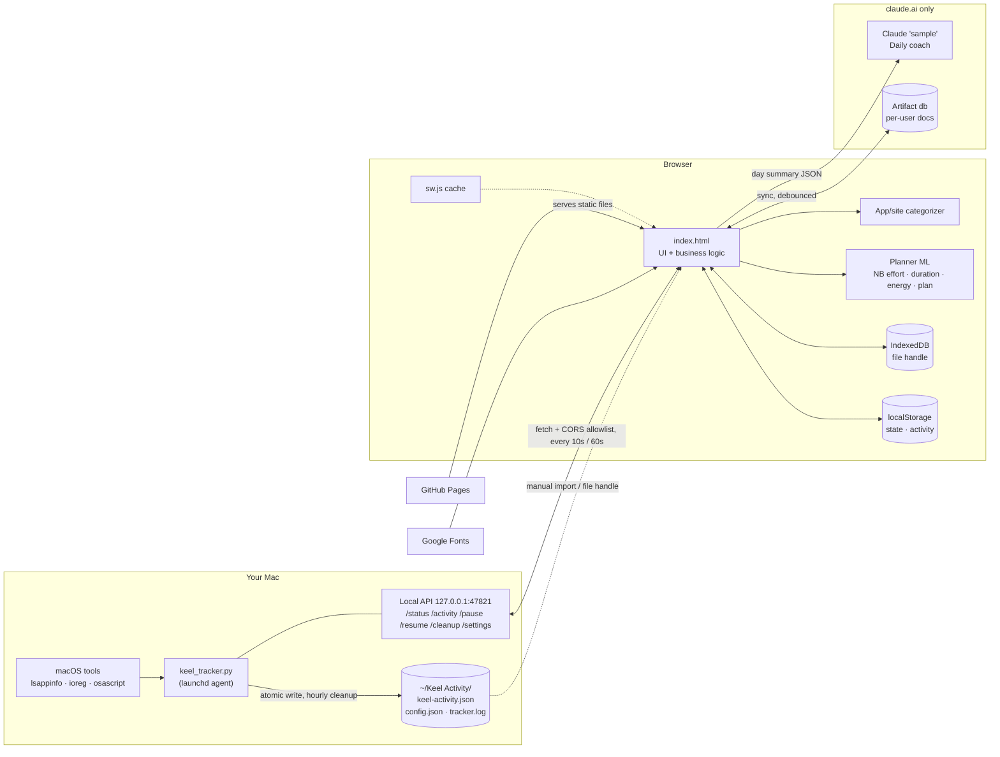

# Keel: test strategy (Phase 1)

Date: 2026-11-10 · Status: **approved by the owner on 2026-11-10**. No code was changed in this phase.

## 1. System map

Keel is a single-user, local-first app. It has no application server, no database server and no user accounts. Its components are:

| # | Component | Technology | Location |
|---|---|---|---|
| C1 | Web app (UI and all business logic) | One `index.html` (~2,500 lines of vanilla JS and CSS), no build step | Browser (GitHub Pages, localhost or claude.ai) |
| C2 | Browser storage | `localStorage` (state and activity), IndexedDB (remembered file handle) | Each browser |
| C3 | Offline / install | `sw.js` service worker and `manifest.json` | Browser (off on claude.ai) |
| C4 | Mac tracker | `tracker/keel_tracker.py` (Python 3, standard library only) run by launchd. It samples the front app, browser tab, URL and title, and idle time. It writes `keel-activity.json`, and cleans up every hour | macOS |
| C5 | Tracker local API | `http.server` on `127.0.0.1:47821`: `GET /status`, `GET /activity`, `POST /pause`, `/resume`, `/cleanup`, `/settings`. Uses an origin allowlist and a Host-header check | macOS |
| C6 | macOS system tools | `lsappinfo`, `ioreg`, `osascript` (needs Automation permission per browser) | macOS |
| C7 | Planner ML (on-device) | Naive Bayes effort classifier, Bayesian duration correction, energy curve, plan builder, pairwise perceptron (in `index.html`) | Browser |
| C8 | App/site categorizer | Rule tables (regex) plus user overrides | Browser |
| C9 | Daily coach (LLM) | Claude via the artifact `sample` capability | **claude.ai only** |
| C10 | Account sync | Artifact `db` and `user` capabilities (per-user private docs) | **claude.ai only** |
| C11 | Third parties | Google Fonts (Inter, Raleway), GitHub Pages hosting | Internet |

There are no queues, workers, vector stores, agents, tool-calling, training pipelines, model servers, payment systems or email.

## 2. Test inventory (current)

| Component | Existing tests | How to run | Result now | Coverage |
|---|---|---|---|---|
| All (C1–C11) | **None.** The repo has no test files, test runner, package.json, pyproject or CI | — | — | 0% (not measured) |
| Baseline checks I ran | JS parse of `index.html` and `sw.js`, `py_compile` of the tracker, JSON parse of the manifest | see `test-progress.md` | **All 4 OK** | — |

The browser smoke scripts and local API `curl` checks I used while building Keel are not in the repo, so they don't count as suites. I'll rebuild them properly as versioned suites in Phases 3 and 5.

## 3. Critical user journeys

| # | Journey | Components |
|---|---|---|
| J1 | Add tasks with quick-add shortcuts, then edit, complete and delete them | C1, C2, C7 |
| J2 | Run a Pomodoro / stopwatch focus session: pause, finish and log it, auto break, away-time prompt | C1, C2 |
| J3 | Dashboard: day calendar, summary, day navigation, log time by clicking the calendar | C1, C2, C8 |
| J4 | Plan my day: suggest an order, reorder (learns), "Not today", add to calendar, correct effort | C1, C7 |
| J5 | Tracker install, then activity appears live in Activity and on the Dashboard | C4, C5, C6, C1, C8 |
| J6 | Pause / resume app tracking from the sidebar and the Activity page | C1, C5, C4 |
| J7 | Recategorize an app or site, or link it to a project | C1, C8 |
| J8 | Reports: switch ranges, read charts and tables, copy CSV | C1 |
| J9 | Storage cleanup: retention settings, Clean up now (browser and tracker), automatic cleanup | C1, C2, C4, C5 |
| J10 | Back up and restore, Erase everything | C1, C2 |
| J11 | Install as an app / open offline | C3 |
| J12 | Import activity file (fallback and claude.ai) | C1, C2 |
| J13 | Daily coach review (claude.ai only) | C9 |
| J14 | Settings: goals, timer lengths, theme, chronotype, reset learning | C1, C7 |

## 4. AI/ML features and risk

| Feature | What it does | Model / provider | Inputs → outputs | Cost of a wrong answer |
|---|---|---|---|---|
| Effort classifier | Labels tasks Light / Medium / Heavy | Multinomial NB with a lexicon prior, temperature-calibrated, trained online | Title, notes, estimate, priority, project, steps → class probabilities plus reasons | **Low.** Shown with "?" and correctable |
| Duration predictor | Corrects estimates for over-optimism | Bayesian shrinkage of log(actual/estimate) per effort class (priors 1.25×–1.5×, ~P75 after 10 samples) | Estimate, effort, finished-task history → minutes | **Medium.** A wrong length breaks the day plan |
| Energy curve | Hour-by-hour focus profile | Prior curve plus decayed observations, smoothed (weekend shift, chronotype) | Sessions and app activity → 24 values | **Low–medium.** Heavy work placed at poor hours |
| Plan builder | Orders the day with times and breaks | WSJF selection, greedy energy-matched ordering, 90-min chunks, lunch/breaks, perceptron feedback | Tasks plus the three models above → timed plan with reasons | **Medium.** Overdue work missed or a day overloaded |
| App/site categorizer | Productive / neutral / distracting | Regex rules plus user overrides (not ML) | App name / domain → category | **Low.** Skews the productivity numbers |
| Daily coach | A short review of the day | Claude via `sample` (model chosen by the platform; not pinnable) | Day stats and task titles → ≤120-word text | **Low–medium.** Wrong numbers or advice; injection through task titles |

## 5. Test strategy by phase

| # | Phase | Proposal | Why / scope | Tools |
|---|---|---|---|---|
| 1 | Discovery | **Applies** | This document | — |
| 2 | Environment & static checks | **Applies** | Add `package.json` (dev-only test deps, lockfile), Python dev requirements, ESLint for the inline JS, Ruff/pyflakes for Python, `npm audit` and `pip-audit`. One command for all tests and one for evals. No `.env`, DB or seed needed, so those parts are N/A | npm, ESLint, Ruff, pip-audit |
| 3 | Backend unit & API tests | **Applies** | "Backend" here means the tracker (segment merging, idle, pause, cleanup, origin/Host checks, every endpoint and error code, concurrency of pause/cleanup vs. writes). It also covers the JS business logic: parser, durations, stats, focus score, cleanup, timer engine. macOS tools are faked in Linux tests | pytest + coverage; Vitest (logic extracted at test time) or Playwright `page.evaluate` |
| 4 | Database & data integrity | **Applies (adapted)** | There's no SQL. Test the state schema migration (`normalize`), backup → restore round trip, localStorage quota handling, the tracker's atomic file writes and corrupt-file recovery, retention, and claude.ai sync merge rules. Vector DB, N+1 and indexes are N/A | pytest, Playwright |
| 5 | Frontend & E2E | **Applies** | J1–J12 and J14 in Chromium, WebKit and Firefox at mobile, tablet and desktop sizes; axe; console errors; coach UI states with a mocked `sample` | Playwright, @axe-core/playwright |
| 6 | Security | **Applies (adapted)** | No login or roles. Test local API origin allowlist, DNS-rebinding (Host) check, CSRF on POSTs, CORS headers, XSS via task / app / window titles and AI output, secrets in the repo, and SW scope. Auth, IDOR, uploads and rate limits mostly N/A, though the import file is an "upload" | pytest, Playwright, gitleaks, semgrep (optional) |
| 7 | Data pipeline & quality (ML) | **Applies (lite)** | Tracker segment schema and quality (overlaps, negatives, durations), feature extraction parity, determinism, train/test separation for the eval sets. RAG is N/A | pytest, Playwright |
| 8 | Model evaluation (ML) | **Applies** | Effort classifier and duration predictor on versioned **synthetic** labelled sets (plus your own tasks if you share them), planner constraint checks, against baselines. Online models, so "reproducibility" means the same seed gives the same metrics | Node/Playwright eval harness |
| 9 | Model serving (ML) | **Applies (lite)** | No model server. Test inference-input validation (odd/huge titles), output contract, batch vs. single parity, planner latency, and graceful fallback when a model throws | Playwright |
| 10 | LLM evaluation (AI) | **Applies (lite, throwaway: approved)** | Daily coach only, on claude.ai only. A 50-case synthetic eval with a rubric needs real `sample` calls inside the artifact, which use your Claude usage, not an API key. The alternative is **SKIP** (coach is optional and low risk) | Playwright against the artifact, rubric scoring |
| 11 | AI safety | **Applies (lite)** | Injection through task titles, notes and synced data into the coach prompt; coach output rendered as text only (XSS); oversized inputs. No agents, tools or cross-user data, and sync is per-user private | Playwright |
| 12 | Performance & cost | **Applies (adapted)** | No multi-user server. Tracker CPU/RAM/API p95, `/activity` size, UI render and planner time with 30 days of data, Lighthouse mobile Web Vitals, storage growth. AI cost $0 API (uses your Claude plan) | Lighthouse, Playwright, `ps`/`time` |
| 13 | Resilience & monitoring | **Applies (adapted)** | Tracker down / paused / blocked, corrupt or huge activity file, fonts offline, storage full, sync unavailable, osascript denied. Logging without sensitive data. Alerts and drift dashboards are N/A for a single-user local app (local health indicators exist instead) | pytest, Playwright |
| 14 | Final report | **Applies** | — | — |

**Where tests run:** web and Python tests run in my Linux workspace with the macOS tools faked. A small set of macOS integration checks would run on your Mac against a **separate test port and a temporary home folder**, never touching your real activity file. That needs your OK.

## 6. Quality targets (approved and locked 2026-11-10)

| Area | Metric | Proposed threshold |
|---|---|---|
| All | Test suites | 100% pass, 0 flaky |
| Logic | Line coverage: tracker (Python) | ≥ 85% |
| Logic | Line coverage: JS business logic (parser, stats, cleanup, timer, planner, sync, import) | ≥ 80% |
| Security | Open Critical / High findings | 0 |
| Security | Disallowed-origin and wrong-Host requests to the tracker API that succeed | 0% |
| Effort classifier | Macro-F1 on the held-out synthetic set (≥ 150 labelled tasks, 3 classes) | ≥ 0.70, and ≥ +0.15 over the majority-class baseline, and ≥ the keyword-only baseline |
| Effort classifier | Gap between best and worst slice (by estimate bucket and by project) | ≤ 0.15 F1 |
| Effort classifier | After 20 user corrections on a new vocabulary, accuracy on that vocabulary | ≥ 0.80 |
| Duration predictor | Median absolute log error vs. the raw estimate on simulated users with a 1.4–1.8× bias | ≥ 30% lower error than the raw estimate |
| Planner | Hard-constraint violations (overlaps, overdue not first, parts out of order, no break after ≥ 75 min continuous work, heavy > 240 min unless forced, plan before "now") | 0 across 500 seeded random days |
| Planner | `buildPlan` latency for 30 tasks with 30 days of history | p95 < 50 ms (desktop Chromium) |
| Daily coach (if not skipped) | Rubric pass rate on 50 synthetic days | ≥ 90% |
| Daily coach | Numbers stated that aren't in the input data | ≤ 5% of responses |
| Daily coach | Injection success via task titles / notes (30 attacks) | 0% |
| Daily coach | Output rendered as HTML / script executed | 0 |
| Frontend | Accessibility: serious/critical axe violations | 0 on every page |
| Frontend | Console errors (excluding blocked third-party fonts offline) | 0 on every page |
| Frontend | Browsers × viewports | Chromium, WebKit and Firefox × 390 / 768 / 1440 px all pass |
| Performance | Tracker API p95 (`/status`) | < 50 ms |
| Performance | Tracker CPU average over 10 min / RSS | < 2% / < 60 MB |
| Performance | Lighthouse mobile LCP / CLS / TBT | < 2.5 s / < 0.1 / < 300 ms |
| Performance | Dashboard render with 30 days of activity | < 150 ms |
| Storage | Browser storage with default retention and 30 heavy days | < 4 MB |
| Storage | Tracker file and log | ≤ configured cap and ≤ 1 MB respectively |
| Cost | Paid API spend | $0 (no API keys used) |

## 7. What I need from you

1. **AI_BUDGET.** The runbook says `$[AMOUNT]`. Keel makes no paid API calls; the coach uses your Claude plan inside claude.ai. I suggest **$0**, with Phase 10's live coach eval either run on your plan usage or skipped.
2. **Phase 10 (coach eval): run lite or SKIP?**
3. **Labelled data for the effort classifier.** May I build a synthetic set of about 200 tasks (Light/Medium/Heavy) and keep it frozen? Do you also want to give me 30–50 of your own real tasks with your labels? These stay local and are never sent to an AI provider.
4. **Mac integration tests:** OK to run a second tracker instance on your Mac on a test port with a temporary home folder for Phases 3, 12 and 13?
5. **Approve or change the thresholds** in section 6.
6. **Staging URL.** Will you have pushed to GitHub Pages by Phase 5? Otherwise I'll test against a local server.
